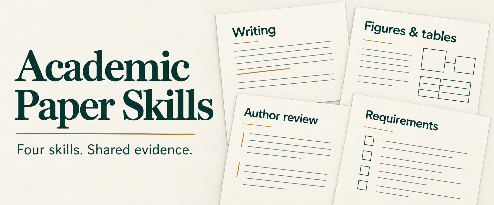

# Academic Paper Skills

Four coordinated Codex skills for writing papers, making figures and tables, revising manuscripts, and checking requirements.

**[Choose a skill](#choose-a-skill)** · [Quick start](#quick-start) · [User guide](docs/getting-started.md) · [简体中文](README.zh-CN.md)

<a href="#choose-a-skill"></a>

[](https://github.com/DELONG-L/Academic-Paper-Skills/actions/workflows/ci.yml) [](LICENSE) [](docs/getting-started.md)

<a id="choose-a-skill"></a>
## What are you working on?

Bring your manuscript, sources, or results. Choose the skill for the task at hand; you can work on one paragraph, one figure, a revision, or a whole paper.

- [**Writing**](paper-writing/SKILL.md) — A clear argument, evidence-grounded sections, and integrated citations.
- [**Figures & tables**](paper-figures-tables/SKILL.md) — Editable diagrams, reproducible plots, and tables suited to the paper.
- [**Author review**](paper-review/SKILL.md) — Prioritized issues, reviewer responses, and revisions checked against the comments.
- [**Requirements**](paper-policy/SKILL.md) — Applicable project or venue requirements, source checks, and unresolved evidence.

Author review supports your own manuscript and responses to reviewers. Assigned external peer review uses a separate workflow.

<a id="quick-start"></a>
## Get started

For a **fresh installation** on macOS or Linux, copy the four skill folders into Codex's skills directory. Keep them together with their existing names so sibling references work.

```bash
git clone https://github.com/DELONG-L/Academic-Paper-Skills.git
cd Academic-Paper-Skills
skills_dir="${CODEX_HOME:-$HOME/.codex}/skills"
mkdir -p "$skills_dir"
cp -R paper-policy paper-writing paper-review paper-figures-tables "$skills_dir/"
```

If any of these folders already exist, follow the [upgrade guide](docs/getting-started.md#upgrade) to preserve local changes. Start a new Codex task after installation, provide your sources, and invoke the relevant skill.

<details>
<summary><strong>Run the Python checks or plotting helpers</strong></summary>

The skill instructions are Markdown. The supporting Python tools use a separate environment:

```bash
python3 -m venv .venv
source .venv/bin/activate
python -m pip install -r requirements-policy.txt
# Also install this for plotting and figure utilities:
python -m pip install -r requirements-figures.txt
```

Python 3.10+ is recommended; CI tests Python 3.11. Image generation and LaTeX compilation require their own tools. See [requirements and troubleshooting](docs/getting-started.md) for task-specific setup.

</details>

<a id="try-it"></a>
## Try a task

**Draft from evidence** · `paper-writing`

```text
Use $paper-writing to revise
this introduction. Preserve the
research question, ground the
contribution in the supplied
results, and flag unsupported
claims.
```

<details>
<summary><strong>Make a figure or table</strong> · paper-figures-tables</summary>

```text
Use $paper-figures-tables to
present the comparisons in these
results. Choose plots or tables
suited to the question, preserve
uncertainty, and provide
editable or reproducible sources
with captions.
```

</details>

<details>
<summary><strong>Check a revision</strong> · paper-review</summary>

```text
Use $paper-review to compare
these reviewer comments with the
revised manuscript. Identify
what is resolved, what evidence
is missing, and what still needs
editing.
```

</details>

<details>
<summary><strong>Check manuscript requirements</strong> · paper-policy</summary>

```text
Use $paper-policy to assess this
submission against the supplied
venue instructions. Separate
verified source checks from
judgments that still need human
evidence.
```

</details>

<a id="how-it-works"></a>
## Shared evidence, separate responsibilities

There is no required sequence through the four skills. For a revision, `paper-review` can identify a weak argument, `paper-writing` can revise the prose, and `paper-figures-tables` can develop the supporting visuals. `paper-policy` resolves applicable requirements and checks their evidence when needed.

They share three principles: **work from sources**, **adapt to the paper**, and **make the result inspectable**. Preserve claim strength and uncertainty, retain editable or reproducible sources where relevant, and distinguish automated checks from scientific judgment and human sign-off.

<a id="repository-map"></a>
<a id="contributing"></a>
## Guides & contributions

[Installation and upgrades](docs/getting-started.md) · [Repository guide](docs/architecture.md) · [Contributing](CONTRIBUTING.md) · [Changes](CHANGELOG.md) · [Visual assets](docs/brand.md)

Corrections and concrete workflow improvements are welcome. Use the issue templates to describe expected behavior and a minimal example. Keep the English and Chinese editions aligned when changing public guidance.

## License

[MIT](LICENSE). Independently maintained; no affiliation with or endorsement by OpenAI is implied. Acknowledgments and preserved third-party notices are in [THIRD_PARTY_NOTICES.md](THIRD_PARTY_NOTICES.md).
